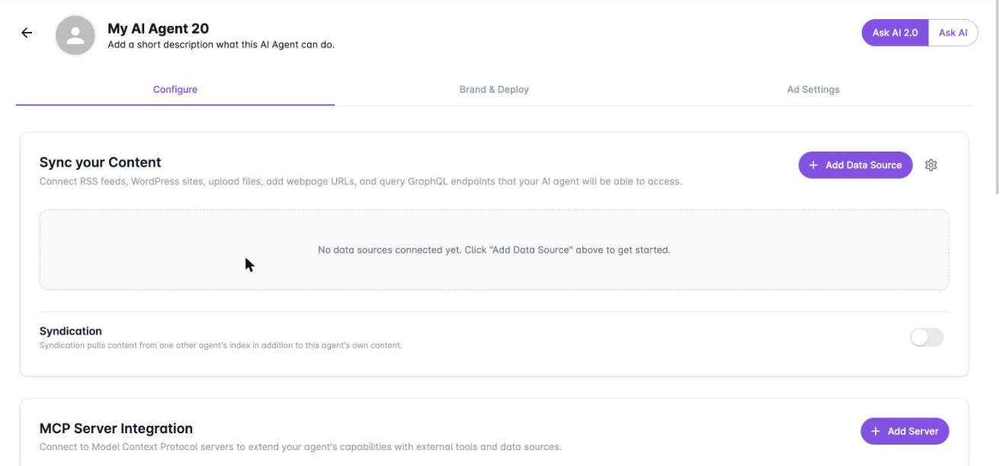
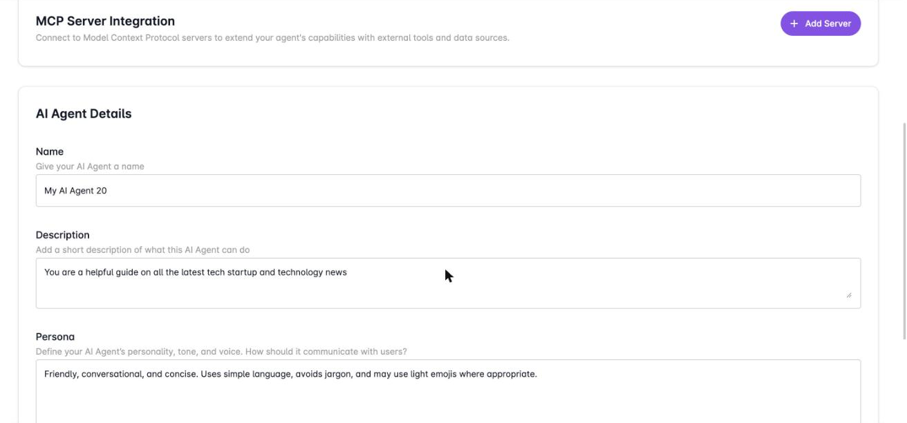

An AI agent is the foundation of every Ask AI experience on Dappier. It holds the content your agent can answer from and the instructions for how it speaks. This page walks through the **Configure** tab, where you connect content and describe the agent before you fine tune it.

## Start a new agent

<Steps>
  <Step title="Open My AI Agents">
    Sign in to the [Dappier platform](https://platform.dappier.com) and select **My AI Agents** in the sidebar.
  </Step>
  <Step title="Create the agent">
    Select **Create New Agent**. The agent opens on the **Configure** tab.
  </Step>
</Steps>

## Sync your content

Select **Add Data Source** and choose the type of source to connect. You can add more than one.

| Source | What it does |
| --- | --- |
| RSS Feed | Connects RSS feeds so new content syncs automatically. |
| Webpage | Crawls and indexes the specific webpage URLs you add. |
| Files | Uploads documents, PDFs, and other files. |
| GraphQL Endpoint | Queries a GraphQL API with custom headers and body. |

After you connect a source, the section shows:

- A tab for each source type with the number of sources connected.
- The **DataModel ID** for the agent's content, which starts with `dm_`.
- A description field where you tell the agent what content these sources contain, so it knows what to expect.
- The time the content was last ingested.

### Syndication

Turn on **Syndication** to pull content from one other agent's index in addition to this agent's own content.

### MCP server integration

Select **Add Server** to connect a Model Context Protocol server. This extends the agent with external tools and data sources.

## Describe your agent

Under **AI Agent Details**, fill in three fields.

| Field | What to enter |
| --- | --- |
| Name | The name of your AI agent. |
| Description | A short description of what the agent can do. |
| Persona | The agent's personality, tone, and voice: how it should communicate with users. |

The **Advanced** section holds optional additional configuration.

## Fine tune and update

Select **Begin fine tuning** to train the agent on your content and settings.

Once the agent exists, its **AI Model ID** (starting with `am_`) appears under the agent name. You can return to the **Configure** tab at any time to add or remove data sources, add optional prompt samples (example questions users might ask about your content), and select **Update** to save your changes.

## Next steps

<Columns cols={2}>
  <Card title="Customize Ask AI" icon="palette" href="/publishers/customize-ask-ai">
    Set the welcome text, branding, theme, and behavior of your agent.
  </Card>
  <Card title="Deploy Ask AI" icon="rocket" href="/publishers/deploy-ask-ai">
    Launch a hosted AI Mode page or embed Ask AI on your site.
  </Card>
</Columns>
