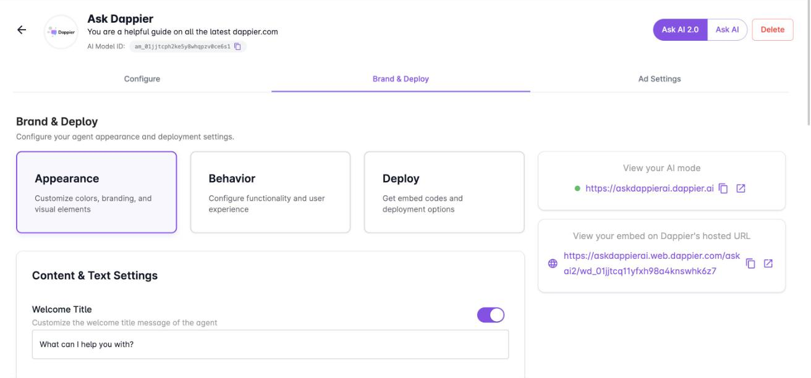
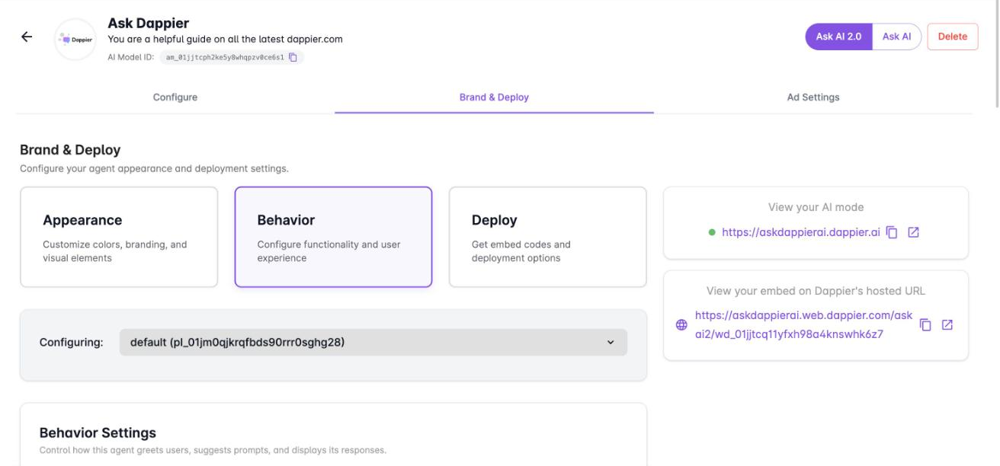

Ask AI is white labeled, so the agent your readers see carries your text, logo, and colors. You control this from the **Brand & Deploy** tab of your agent, which has three sections: **Appearance**, **Behavior**, and **Deploy**. This page covers the first two. For embed codes and hosting, see [Deploy Ask AI](/publishers/deploy-ask-ai).

To get there, open **My AI Agents**, select your agent, and select **Brand & Deploy**. Select **Update Agent** after any change to save it.

## Appearance

### Content and text settings

| Setting | What it controls |
| --- | --- |
| Welcome Title | The welcome title message of the agent. Use the toggle to show or hide it. |
| Welcome Description | A short introductory message that guides users when they first see the agent. Up to 180 characters. Use the toggle to show or hide it. |
| Welcome Title / Description Alignment | Whether the welcome title and description are aligned left or center. |
| Input Placeholder Text | The placeholder shown in the input box. The default is "Ask a question...". |
| Disclaimer Text | The message shown when users hover over the Dappier Sparkles icon or the Powered by Dappier logo. |

### Branding and theme

| Setting | What it controls |
| --- | --- |
| Logo | The logo shown in the agent. Paste a direct image URL (PNG, JPG, or SVG) or upload a file. |
| Primary Color | A hex color that themes the entire agent, including buttons and highlights. |
| Gradient Background | A subtle gradient background based on the primary color. Light theme only. |
| Theme Mode | Light, Dark, or Device. Background, text, and border colors adjust automatically. |

## Behavior

Behavior settings control how the agent greets users, suggests prompts, and displays its responses. The **Configuring** menu at the top of the section shows which placement you are editing.

| Setting | What it does |
| --- | --- |
| Show Widget Header on Load | Shows the widget header when the agent first loads. |
| Free-Form Text Input | Lets users type their own questions. Turn it off to hide the input field so the agent is driven by prompt suggestions only. |
| Prompt Suggestions | Displays context-aware, AI-generated prompt suggestions to help users get started. |
| Prompt Suggestions View on load | Shows suggestions stacked in chat responses or in a scrollable single line above the input. |
| Open Links in New Window | Opens content links clicked within the agent in a new browser tab. |
| Related Content | Shows a "Related Content" button below responses to surface relevant articles or content. |
| Show Site Name | When related content is on, shows the source site name in the related content carousel. |
| Show Published Date | Shows the published date for each item in the related content carousel. |
| Response Display Mode | Where AI responses are displayed. Applies to embeds only, and placements can override it. |
| Enable Ads | Shows advertisements across the agent. |
| Show Initial Search Query | Displays the search query in results. |

### More behavior sections

Below the main settings, expand any of these sections to configure it.

| Section | What it does |
| --- | --- |
| Dockable Agent Settings | Lets the agent dock to the edge of the page so users can open it from anywhere on your site. |
| Amplify Mode Settings | Lets the agent run a predefined query and redirect users to a destination of your choice. |
| Lead Capture | Lets the agent detect high-intent moments and collect contact details from users. |
| AI Search Settings | Lets the agent power an AI-driven search experience. These are the defaults every placement inherits unless it overrides them. |
| Link Settings | Adds the header, footer, and legal links that appear around the agent. |
| Advanced Settings | Sets the API key, referring URL, and analytics the agent uses. |

<Note>
  The individual options inside these sections are still to be documented here. Open each section in the platform to see its current options.
</Note>
