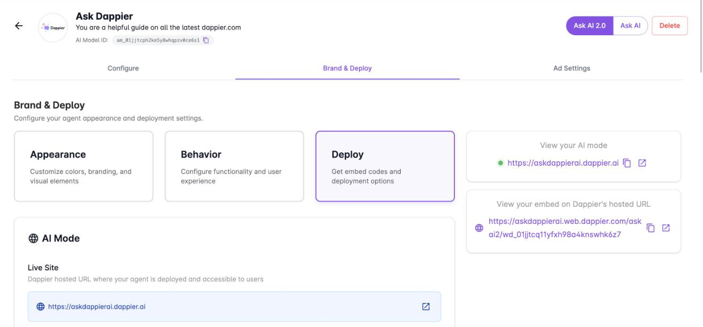

You can put an Ask AI agent in front of readers in two ways: as **AI Mode**, a full answer page hosted on its own URL, or as an **embed** inside your existing pages. Both are set up in the **Deploy** section of your agent's **Brand & Deploy** tab.

To get there, open **My AI Agents**, select your agent, select **Brand & Deploy**, then select **Deploy**.



The panel on the right of the tab links to both live versions of your agent: **View your AI mode** and **View your embed on Dappier's hosted URL**. Use them to preview changes.

## AI Mode

AI Mode is a hosted answer page for your agent.

| Setting | What it does |
| --- | --- |
| Live Site | The Dappier hosted URL where your agent is deployed and accessible to users. |
| Add Existing Domain | Connects your own custom domain to the agent. Select **Add Domain** to start. |
| SEO Settings | Optimizes search engine visibility for your answer page. |
| Answer Page Theme | Sets the hosted answer page to Light, Dark, or Device. Select **Update Theme** to save. |

## Embed Ask AI

Use an embed to place Ask AI inside your own pages.

### Configure the embed

| Setting | What it does |
| --- | --- |
| Embed Type | The kind of embed, such as In Article / Side Rail. Height is configured separately for each type. |
| Height | How the widget height behaves on mobile and on desktop. For example, a fixed height sets a specific height, and a max height sets a maximum with flexible content. |
| Allowed Domains Support | The domains where the agent is allowed to load. Only these domains are authorized. Use full domains such as `mydomain.com`, or wildcard subdomains such as `*.example.com`. |
| Version | The widget version to load. |

Select **Update Agent** to save.

### Choose a placement

A placement is a deployment configuration for a specific location or use case of your agent. Under **Placement**, select an existing placement or create a new one. Every agent starts with a `default` placement.

### Add the code to your site

The Deploy section generates both snippets with your widget ID filled in. Copy them from the platform.

<Steps>
  <Step title="Add the script to the head tag">
    This script loads the Dappier widget on your page.

    ```html
    <!-- Add to the head tag -->
    <script
      src="https://assets.dappier.com/widget/dappier-loader.min.js"
      widget-id="YOUR_WIDGET_ID"
    >
    </script>
    ```
  </Step>
  <Step title="Add the widget tag to the body">
    Place this tag wherever you want the widget to appear within the `<body>` of your HTML document.

    ```html
    <div id="dappier-ask-ai-widget">
      <dappier-ask-ai-widget
        widgetId="YOUR_WIDGET_ID"
      />
    </div>
    ```
  </Step>
</Steps>

Widget IDs start with `wd_`.

## Related

<Columns cols={2}>
  <Card title="Customize Ask AI" icon="palette" href="/publishers/customize-ask-ai">
    Set welcome text, branding, and behavior, including dockable mode.
  </Card>
  <Card title="WordPress plugin" icon="wordpress" href="/wordpress">
    Add Ask AI to a WordPress site.
  </Card>
</Columns>
